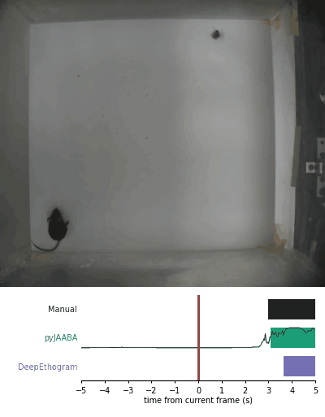
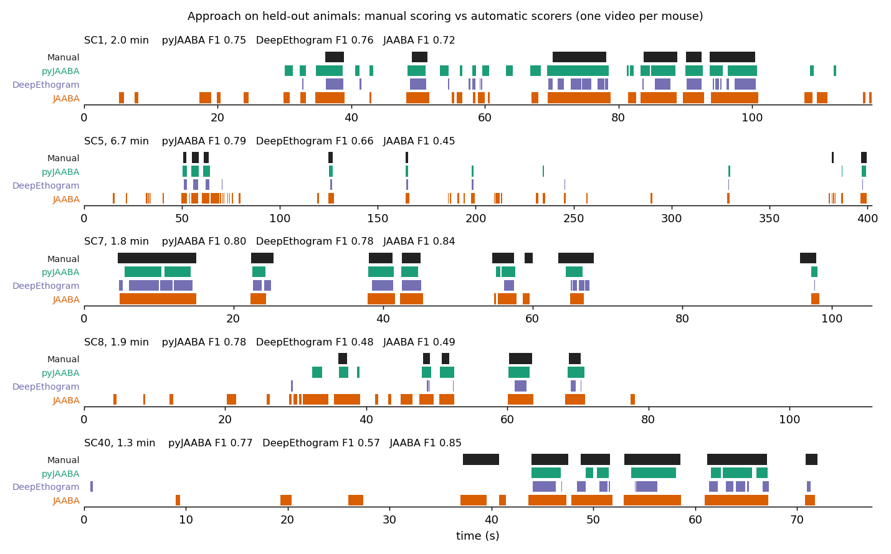
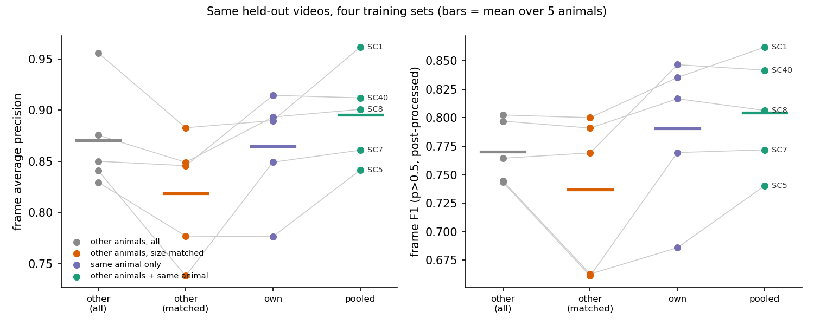
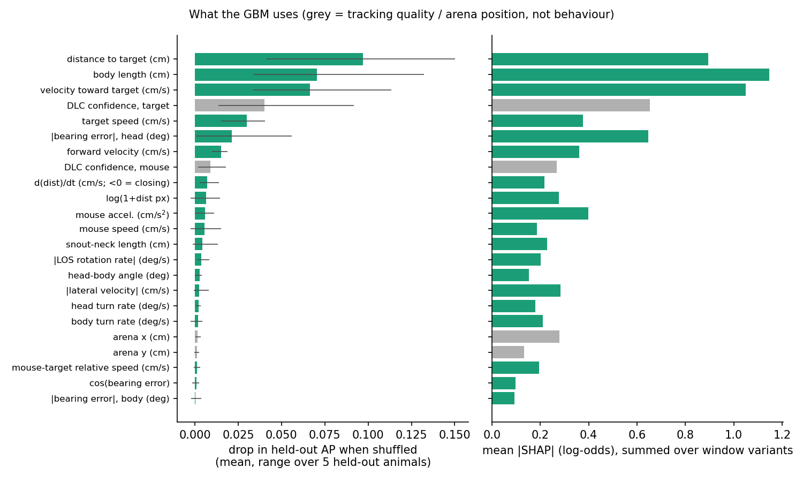
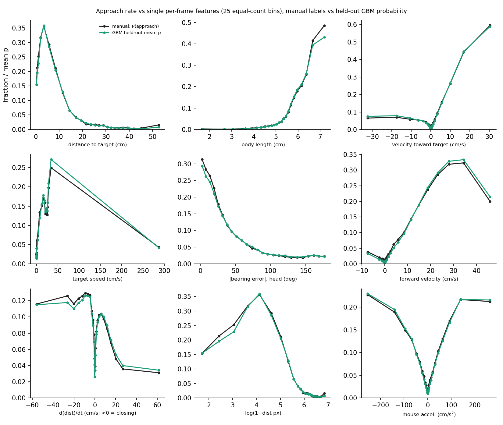
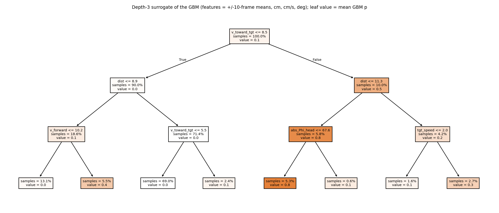

# Validation: scoring mouse prey approach

pyJAABA was built for, and validated on, one behaviour: **approach** (a mouse hunting
a moving target, as scored by hand in BORIS) in overhead videos. This page reports how well it matches manual scoring, how it
compares with JAABA and DeepEthogram, how much animals differ, and what the classifier
learned. In the figures, "GBM" (gradient-boosted model) is pyJAABA.

*A held-out mouse (never in training) starts and stops a hunt. Below the video: manual
scoring, pyJAABA (bars = calls, line = probability) and DeepEthogram, over $\pm 5$ s
around the current frame (red line).*

## Data

- **5 mice, 84 videos, 379,083 frames** at 30 fps (1120$\times$988 px, overhead camera),
  **420 manual approach bouts**, scored in BORIS. 4 mice hunted a moving "roach" target in one
  arena; 1 (SC40) hunted a moving chip in another. 17 videos contain no approach and
  are used as all-negative.
- Pose from one single-animal DeepLabCut network: 8 mouse bodyparts (snout, neck,
  ears, 3 spine points, tailbase) and two target bodyparts (`puck`, `food`); the
  more confident target is used each frame.

## How it was scored

Every number is on **held-out data split by whole animal** (leave-one-animal-out,
"LOAO"): each mouse is scored by a model trained only on the other four. Frames are
never split, because adjacent frames are near-duplicates and a frame split leaks.

- **Frame precision / recall / F1**: after post-processing (5-frame mean, threshold
  0.5, gaps under 5 frames filled, bouts under 8 frames dropped), pooled over all frames.
- **AP** (average precision): area under the precision-recall curve of the raw
  probability; threshold-free. Chance equals the fraction of approach frames, 4-12%
  per mouse.
- **Bout recall**: fraction of manual bouts overlapped by any predicted bout.

## Results

| scorer | AP | precision | recall | F1 |
|---|---|---|---|---|
| **pyJAABA** (`approach_v1`, all features) | **0.846** | 0.804 | 0.740 | **0.770** |
| pyJAABA (`approach_v1_noconf`, no DLC likelihoods) | 0.837 | 0.797 | 0.733 | 0.764 |
| JAABA (MATLAB), same pose, same splits | 0.804 | 0.48 | 0.89 | 0.62 |
| DeepEthogram, from video, same splits | 0.676 | 0.72 | 0.55 | 0.63 |

pyJAABA finds 81% of manual bouts, and per-video % time in approach correlates with
manual at $r = 0.91$. Per mouse, its AP ranges 0.83-0.96, and it beats both other
scorers on every mouse.

*One held-out video per mouse, chosen as the one whose pyJAABA F1 is nearest the
median video (0.79), so these are typical rather than best cases.*

- **JAABA** was trained on the same DLC tracks, with the mouse and the target exported
  as two "flies" so its built-in features cover distance, angle and closing speed. It
  **over-calls**: recall 0.89 at precision 0.48; raising its threshold only reaches F1
  0.67. A likely reason (untested): it trains on labelled bouts plus sampled negatives,
  so it rarely sees "fast running that is not a hunt", and its single-feature boosted
  stumps cannot form conjunctions.
- **DeepEthogram** was trained from the videos themselves (downsampled to 256$\times$224,
  every frame kept; `deg_f` preset, Kinetics-pretrained, GPU), at about **1/10 of its
  default training budget** so five folds fit in ~10 h. It **under-calls**: precision
  0.72, recall 0.55. A full-budget run might narrow the 0.17 AP gap; that is untested.
- **Post-processing** changes frame F1 very little (0.766 raw threshold vs 0.770), but
  turns 1,161 flickering predicted bouts into 516, against 420 manual: its job is bout
  shape.

## Do animals differ?

Within each mouse, videos were split 5 ways and each held-out video predicted by four
models:

| training set | meaning |
|---|---|
| other (all) | the other 4 mice, all their videos (= LOAO) |
| other (matched) | other mice's videos, drawn to the same frame count as *own* |
| own | this mouse's other videos only |
| pooled | the other 4 mice + this mouse's other videos |

| mean over mice | other (all) | other (matched) | own | pooled |
|---|---|---|---|---|
| AP | 0.870 | 0.819 | 0.865 | **0.895** |
| F1 | 0.770 | 0.737 | 0.791 | **0.804** |

- At equal amounts of data, a mouse's own videos beat other mice's (+0.046 AP), so
  animals (or their setup and scoring sessions, which are confounded with the animal
  here) have something idiosyncratic.
- But enough data from other mice matches a per-mouse model, so most of the per-mouse
  advantage is data quantity.
- **Best: pool everything, plus a few labelled videos of the new animal.** That helps
  most for the mouse least like the rest (SC40, the only chip hunter: +0.06 AP).

## What the classifier uses

Each pose quantity enters the model about 20 times (raw, plus window statistics), so
importance is grouped: a quantity and all its window variants are shuffled together
(permutation, scored on held-out mice), or their SHAP values summed. Both methods agree
on the top of the list.

1. **Distance to target**, 2. **body length** (neck to tailbase), 3. **velocity toward
   the target**, then target speed and **head** bearing to the target.
- Bearing on the **body** axis is almost unused: pointing the *head* at the target is the cue.
- **Body length** was the surprise: approach frames are the stretched ones. Likely
  pursuit locomotion as opposed to the hunched posture of eating or grooming (untested).
- **Target DLC likelihood** ranks 4th although it measures tracking, not behaviour (low
  confidence ~ "no target in view"). Dropping both likelihood features costs only 0.006
  F1, and makes the model less sensitive to a change of DLC network, so
  `approach_v1_noconf` is the one to use on new data.
- Arena position contributes almost nothing.

**Shapes of the dependences.** Approach rate in bins of single features, for the manual
labels and for pyJAABA's held-out probability. pyJAABA tracks the manual curves closely.

- **Distance**: peaks at ~3-5 cm and falls to near zero beyond 20 cm, with a dip at
  contact (under 1 cm).
- **Velocity toward target**: near zero for $\le 0$ cm/s, rising roughly linearly to
  ~0.6 at 30 cm/s.
- **Head bearing**: declines monotonically from ~0.3 at 0$^\circ$ to ~0.02 beyond 100$^\circ$.

(Distances in cm assume a scale of 820/18/2.54 px/cm, which was not verified for these
videos. A different scale rescales the cm axes, not any performance number.)

## A readable rule

A shallow regression tree was fit to mimic pyJAABA's held-out probability, using
$\pm 10$-frame means of 11 behavioural quantities (no tracking confidence, no arena
position). Fidelity and accuracy are themselves leave-one-animal-out.

> **Approach** $\approx$ moving toward the target at more than 8.5 cm/s **and** within
> 11.3 cm of it **and** head pointed within 68$^\circ$ of it (p $\approx$ 0.8; 5% of frames).

| rule depth | agrees with pyJAABA | F1 vs manual | AP vs manual |
|---|---|---|---|
| 2 | 95.2% | 0.61 | 0.54 |
| 3 | 95.5% | 0.64 | 0.62 |
| 4 | 96.2% | 0.72 | 0.71 |
| pyJAABA | | 0.77 | 0.85 |

The rule agrees with pyJAABA on 95% of frames, mostly because both say "no" to the
~70% of frames that are obviously not approach. On the frames that matter it gives up
0.13 F1 at depth 3. So approach is *mostly* "closing fast on a nearby target the head
points at", and pyJAABA's extra accuracy comes from posture, target motion and timing
detail that a few thresholds cannot express.

## Disagreements are worth reading

In the video with the most false-alarm frames, pyJAABA's extra bouts between the manual
ones line up with short spikes in velocity toward the target: brief lunges the scorer
did not call approach. Whether they should be is a question for the scoring definition,
not a classifier bug. Used this way, pyJAABA's false alarms are a list of candidate
missed labels to re-check.

## Checks

- pyJAABA's `verify` reproduces this study's per-frame features, window features and
  leave-one-animal-out probabilities exactly (max $|\Delta p| = 0$).
- Shuffling every feature drives AP to the positive rate for every mouse (the
  permutation harness decouples rows from labels as it should).
- SHAP additivity holds to $10^{-15}$.

The videos, tracks and labels behind this page are not public; the figures were made from them by scripts in the lab's analysis repository.
